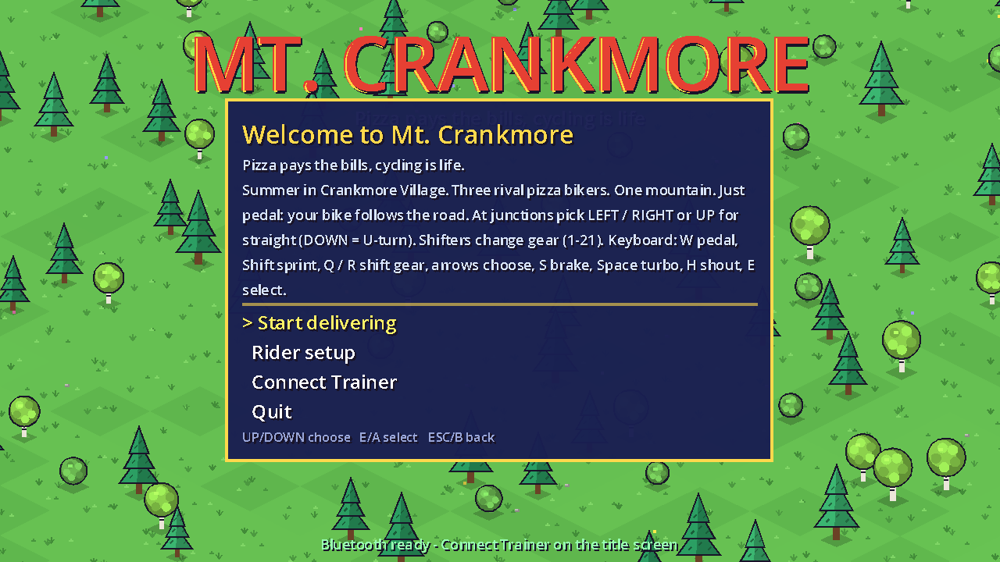
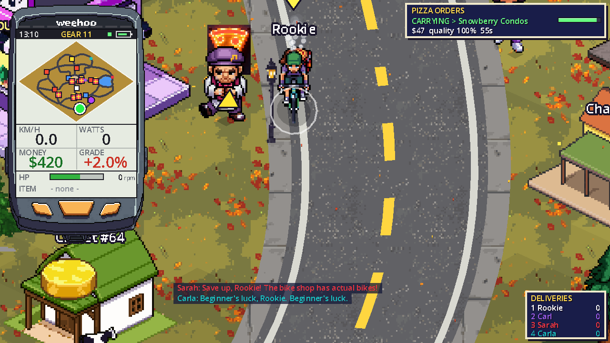

# Mt. Crankmore

> *Pizza pays the bills, cycling is life.*

A colorful 16-bit-style isometric pizza-delivery racing game set in Crankmore Village, an isolated mountain resort town, through all four seasons, built in **Godot 4**.
The game renders at 640x360 and scales up with crisp integer pixels (2x in the default 1280x720 window).
Pedal a **bicycle trainer** (optionally with handlebar controllers) to ride; rival pizza bikers (3 by default, up to 7) trash-talk you the whole way.





## Play

Download the latest build for your system from the [Releases page](https://github.com/hermeslohin/mt-crankmore/releases) (currently **0.5**):

| Platform | File | How to run |
|---|---|---|
| Windows | `MtCrankmore-windows-x86_64.zip` | unzip, run `MtCrankmore.exe` |
| macOS | `MtCrankmore-macos.zip` (universal) | unzip, then right-click the app > Open the first time (it's ad-hoc signed, not notarized). If macOS says it's "damaged", run `xattr -cr "Mt. Crankmore.app"` once |
| Linux | `MtCrankmore-linux-x86_64.tar.gz` | extract, `chmod +x MtCrankmore-linux-x86_64`, run it |

**Mac note:** the app is ad-hoc signed but not notarized by Apple, so the first time you open it, right-click (or Control-click) the app and choose **Open**, then confirm. If macOS says the app is "damaged and can't be opened", that is just the download quarantine flag; clear it once in Terminal and open the app again:

```
xattr -cr "/path/to/Mt. Crankmore.app"
```

The game works with just a keyboard. A trainer needs Python 3 and internet once (see [Bicycle trainer](#bicycle-trainer)).

Or run it from source:

```
godot --path .          # or open this folder in the Godot 4 editor and press F5
```

To build the release packages yourself, install the Godot 4.7 export templates and run
`godot --headless --export-release Windows|Linux|macOS` (presets are in `export_presets.cfg`; output goes to `dist/`).

### Continue / New game
The title screen has **Continue game** (resumes your save, showing your money and deliveries; greyed out if there is no save) and **New game**, which **deletes your save** and starts you over with **$100**, one Rusty Trash Bike and zero deliveries. Your rider setup (Rookie Boy or Girl, FTP, weight, rivals) is kept.

### Rider setup
The first time you start delivering (and any time from the title screen or the pause menu) the **Rider setup** screen asks for:

* **Rider**: **Rookie Boy** or **Rookie Girl**, the character you ride as.
* **FTP** (watts) and **weight**, shown in **kg or lbs**. Your weight is used in the physics, so climbs feel like they do outside.
* **Difficulty**: in town, rivals get a W/kg similar to yours (*Easy* about 85% of it, *Medium* about the same, *Hard* about 12% more, *Ludicrous* about 20% more, with better bikes on the harder levels). In a race they hold a share of *your* FTP (as W/kg, at their own weight): about 40% on *Easy*, 50% on *Medium*, 60% on *Hard* and 80% on *Ludicrous* (plus the odd surge).
* **Rival bikers**: how many ride against you, 1 to 8 (default 3).

Change values with LEFT / RIGHT (hold to go faster), on the keyboard or the handlebar D-pad. Without a trainer, W rides at 85% of your FTP and Shift sprints.

### Riding on rails
In town you don't steer: just pedal and the bike follows the road. Your only job is choosing a direction at junctions.
You can still pick your line: squeeze a handlebar paddle to slide across your lane, from the kerb towards the centre line and back. Turns are only picked with the D-pad (or the arrow keys).
A **TURN IN ...m** panel pops up several seconds before every crossroads with three arrows. The yellow one is your choice (straight by default),
and the green **GPS** tag marks the way to your current pickup or delivery. Painted arrows on the road show where you'll go.
One tap is enough: the choice sticks until the junction (no need to hold the button), and the bike curves smoothly through the turn.
If a car is heading for the junction you'll see **CAR COMING!** and you can brake to let it pass.
Pickups and deliveries happen automatically: the bike coasts up to the window and the pizza is handed over as you ride past.

### Controls
| Controller | Keyboard | Action |
|---|---|---|
| pedal | W (210 W), Shift+W sprint | ride |
| D-pad left / right | Left / Right (or A / D) | choose turn at the next junction; in a race, move across the road |
| left / right paddle | | move across the road (town and races); never picks a turn |
| D-pad up | Up | choose straight |
| D-pad down | Down | U-turn |
| A | E / Enter | enter bike shop / race HQ, menu select |
| B | Esc | pause / back |
| RS1 (right shifter) | R or ] | shift up (harder gear) |
| LS1 (left shifter) | Q or [ | shift down (easier gear) |
| Y, RS2 or right power-up | Y or Space | use your power-up |
| LS2 or left power-up | S | brake |
| Z | H | shout at the rivals |
| | F11 or Alt+Enter | toggle fullscreen (the game starts fullscreen) |

### Virtual shifting
The bike has 21 gears: 1 is the easiest, 21 the hardest, and you start in 11. The range is wide: gear 1 pushes back about a third as hard as gear 11, and gear 21 about two and a half times as hard. There is no front/rear shifter juggling, just up and down. The current gear shows at the top of the WEEHOO bike computer.
With a trainer connected, the gear changes the resistance the trainer sends to your pedals. An easier gear pushes back less, so at the same cadence you make fewer watts and go slower; a harder gear is the reverse. Speed in the game still comes from your real power. Keyboard riders get the same effect: W makes fewer watts and spins faster in low gears.
Resistance needs a trainer that accepts FTMS simulation control.

### Bicycle trainer
On the title screen choose **Connect Trainer**:

1. **Install Bluetooth helper (one time)**: the game sets up a private Python environment in `bridge/.venv` (in a packaged build, in a `bridge` folder in the game's user data folder) with the Bluetooth library. Needs Python 3 (`brew install python` or python.org) and internet, about a minute.
2. The helper starts and scans. Pedal / press a button so your devices wake up; they appear as `TRAINER ...` and `CONTROLS ...`.
3. Select your trainer and your handlebar controllers. The status lines show live power/cadence and the buttons you press, so you can check everything works.
4. Done. Your choices are remembered (`bridge/devices.json`) and reconnect automatically every time you start the game; select a connected device to disconnect it.

Quit any other trainer app first: BLE devices only accept one connection. On macOS, allow Bluetooth for Godot (or your terminal) when asked
(System Settings > Privacy & Security > Bluetooth).

Godot itself can't use Bluetooth, which is why the helper (`bridge/trainer_bridge.py`) exists. You can also run it by hand:
`bridge/.venv/bin/python bridge/trainer_bridge.py` (auto-connects the first trainer/controls it finds), `--scan`, `--dump`, `--fake`.

* **Trainer**: standard FTMS. Your real power and cadence drive your speed. The game puts the trainer in simulation mode and sends the road grade (town hills and Mt. Crankmore, -7% to +12%) so climbs get harder and descents easier, with an extra kick when you hop a fallen tree or wade a creek; it repeats the grade every 2 s so the trainer doesn't fall back to a fixed resistance, and goes flat in menus, the bike shop and the ER. The helper log (`grade -> +6.3%`, `trainer: resistance control ready`) shows what is being sent.
* **Controllers**: see the controls table above.

> **Heads-up:** the trainer side uses a published standard. The handlebar controller protocol is proprietary and reverse-engineered by the community. The button bit-map in `bridge/trainer_bridge.py` is a best-effort default that I could not test against real hardware. If a button misbehaves, run `bridge/.venv/bin/python bridge/trainer_bridge.py --learn`: it asks you to press each button and writes `bridge/buttons.json`, which overrides the defaults.

The game shows connection status at the bottom of the screen ("Trainer + controllers connected").

### Strava
Every ride is recorded: distance, speed, power, cadence and altitude (built up from the road grade, in town and on Mt. Crankmore), plus the pizzas you deliver, the races you win and up to 4 screenshots (deliveries, race finishes and the odd bit of scenery; the best moments are kept). Power and cadence only come from a trainer: on the keyboard only speed and distance are logged, so Strava never gets made-up watts.
The ride is kept until you post it, even if you quit the game, and is posted as a **Virtual Ride**. Its notes look like this:

```
Pizza delivered: 5
Races won: 1

Mt Crankmore - Pizza pays the bills, Cycling is life
https://github.com/hermeslohin/mt-crankmore/releases
```

**Linking (one time).** Strava doesn't give games shared app keys, so you make your own free API app:

1. Title screen > **Strava** > **Open Strava API settings** (or go to <https://www.strava.com/settings/api>) and create an app. Any name, category and website will do; set **Authorization Callback Domain** to `localhost`.
2. Copy the **Client ID**, then pick **Paste Client ID**. Click **Show** next to the Client Secret, copy it, then pick **Paste Client Secret**. They're kept only on your computer (`strava.json` in the game's user data folder).
3. Pick **Link Strava account**, approve Mt. Crankmore in your browser (leave *Upload your activities* ticked) and come back to the game.

**Posting.** Once you're linked, post the ride whenever you like: Pause (Esc / B) > **Post ride to Strava**, or title screen > **Strava** > **Post this ride to Strava**. Quitting doesn't post it; the ride is kept until you do. Rides need to be at least a minute long. **Discard this ride** starts a new one.

**Screenshots.** Strava's API doesn't let apps add photos to an activity, so after posting, pick **Add screenshots to the last ride**: it opens the activity in your browser and the folder with that ride's screenshots, ready to drag in.

## The game

* **Orders**: pizza shops ring you with orders. A pizza man dances outside the shop holding the steaming box over his head; ride up, slow down, and he hands it to you. The steam on your bike shows how hot the pizza still is: deliver before the timer runs out or the customer won't pay at all. Faster means bigger tips, crashes hurt the pizza.
* **Seasons**: the village and the mountain change with the season. It follows today's date (northern hemisphere) unless you pick one with **Season** on the title screen or in the pause menu (LEFT / RIGHT).
  * *Spring*: fresh grass full of flowers, trees in pink and white blossom, tulip beds, butterflies, duck families on the lake, flower baskets on the lamp posts and drifting petals.
  * *Summer*: the village as it always was, plus people playing catch and frisbee, flying kites, picnicking (with pizza) and playing beach volleyball; kites and picnics along the race courses too.
  * *Fall*: golden-orange grass, orange, red and yellow trees, golden larches, falling leaves, pumpkins and jack-o'-lanterns, leaf piles with kids jumping in, scarecrows, hay bales and corn stalks on the lamp posts.
  * *Winter*: snow everywhere, snow on the roofs and pines, bare trees, falling snow, a frozen lake with skaters, a frozen fountain, snowmen, skiers on the hills, townsfolk in bobble hats carrying their skis, and wreaths on the lamp posts. The rivals have something to say about every season.
* **Townsfolk**: people stroll the pavements all over the village and cheer you on as you ride past.
* **Rivals**: up to eight AI bikers (Cryptic Carl, Super Sarah, Cadence Carla, Wheelie Wanda, Gear Grinder Gus, Margherita Maya, Tubeless Tony, Karate Kim; the first three ride by default) chase the same orders and will snag them if they reach the window first. They talk trash constantly (family-friendly).
* **Bikes**: you start on a Rusty Trash Bike. **Spokes & Stuff** sells better ones (lighter, more aero, tougher, handle better) and repairs. Bikes have HP; walls and cars damage them, and at 0 HP a bike is destroyed.
* **Cars**: get hit and you wake up at **St. Pedro's Hospital** (it has a helicopter pad on the roof) with a medical bill (money can go negative) and a banged-up bike.
* **The village**: winding roads around a cobbled plaza full of shops and market stalls, a lake with a beach and dock, hotels by the water and the gondola, chalet neighbourhoods in the woods, and only light traffic.
* **Hills**: the plaza and the lakeshore are flat; the chalet neighbourhoods, Summit Road, Ridge Road and the climb up to the gondola roll up to about 7% (Gondola Way pitches to 9%). The grade is shown on your WEEHOO, slows you down uphill and speeds you up downhill (rivals too), and is sent to your trainer.
* **Mt. Crankmore**: enter races at the Race HQ (the checkered building by the gondola). Three gravel races against your rivals (Foothill Gravel Grind, 6 km averaging 4%; Summit Gravel Showdown, 4.4 km averaging 6.5% with ramps up to 12%; and **Flour Run**, a 3 km ride through the flower meadows that climbs, dips and flattens out before finishing back level with the start, about 10 minutes) using a real power/weight/aero/grade model with extra gravel rolling resistance, drafting, power-ups, and prize money. Crossing the line doesn't end the ride: every course runs on for a 400 m cool-down, and the results come up at the end of it. The Gravel Grinder ($8000, the priciest bike in the shop) shines here. The **Fixie** ($2000) is completely impractical, but utterly awesome: stuck in gear 9, no shifting, no brakes.
  * **Drafting**: sit 1 to 9 m behind another rider in the same line (steer with LEFT / RIGHT or the paddles) and the same speed takes fewer watts: about 18% less at 13 km/h, 24% at 17 km/h and 30% at 40 km/h and above. **DRAFTING -n% watts** shows at the bottom of the screen, with wind streaks around your bike. The rivals draft too, off you and off each other.
  * The mountain is built at the same scale as the town (about 3.3 m per tile), so race speeds look like town speeds. Long switchbacks with hairpins zig-zag up a hillside of meadows, pine forest, rock and snow, and the profile rolls: long climbs broken up by short plunges and steep kickers.
  * **Jumps** on the descents (hit one above ~30 km/h for BIG AIR), **fallen trees** you hop (they scrub some speed), and **creek fords** that drag you down while you splash through. Yellow warning signs come up before each one, and they're marked on the WEEHOO profile (blue creeks, orange jumps, brown logs).
  * **Wildlife**: deer, foxes and squirrels dash across the road in front of you, rabbits bolt, moose wade near the creeks, goats and marmots watch from the rocks, eagles circle overhead, and bears give chase. Keep pedalling or the bear takes a swipe at your bike.
* **Power-ups**: about 1 in 8 townsfolk hold up a gift box, and spectators along the race course do too. Ride past with empty hands and they toss you a power-up. You carry one at a time; it shows on the WEEHOO, and **Y** (or Space) uses it. The rivals grab and use them too.
  * *Town only*: **Pepperoni Portal** warps you to the nearest pizza shop with a pizza waiting. **Bike Wrench** fixes your bike to full HP. **Walkie Talkie** summons a pizza mascot that dances in front of the nearest rival and slows them to a crawl for 12 s.
  * *Town and races*: **Pizza Frisbee** knocks a rival within 5 m off their bike for 5 s (out of range, you keep it). **Fire Socks** make you 30% faster for 15 s. **Breadsticks** make you huge for 12 s, and anyone you ride into falls over. **Dough Roller** rolls the hills flat for 15 s: climbs feel like flat road (on the trainer too), descents still count.
* **WEEHOO**: your bike computer in the bottom-right corner. It shows the town map (or the course profile in a race), speed, watts, money (race position in a race), grade, cadence, HP and the power-up you are carrying (or how long Fire Socks / Breadsticks have left). The LED strip along the top lights up with your power, coloured by zone relative to your FTP.
* Progress (money, bikes, HP) is saved automatically. Start over any time with **New game** on the title screen.

## Layout

```
project.godot
export_presets.cfg        Windows / Linux / macOS export presets
scenes/main.tscn          entry scene (everything else is built in code)
scripts/game.gd           autoload: money, bikes, physics, save/load, input map
scripts/trainer_link.gd     autoload: UDP link to the bridge + keyboard fallback
scripts/trash_talk.gd     autoload: rivals and their trash talk
scripts/season.gd         autoload: the current season, its colours and seasonal drawing helpers
scripts/weather.gd        falling snow, leaves and petals
scripts/ride_log.gd       autoload: records the ride (samples, screenshots) and writes it as TCX
scripts/strava.gd         autoload: Strava linking (OAuth via localhost) and ride upload
scripts/main.gd           mode switching and menus
scripts/city.gd           isometric city, traffic, rivals, orders
scripts/race.gd           Mt. Crankmore switchbacks, terrain, obstacles, wildlife + race sim
scripts/powerups.gd       power-up definitions and drawing (icons, gift, frisbee, mascot)
scripts/hud.gd            HUD and menus
scripts/iso.gd, bike_draw.gd   drawing helpers
bridge/trainer_bridge.py    BLE <-> UDP bridge (Python, bleak)
```

The scenery is drawn in code, but everything that moves or stands out is pixel art from PixelLab, kept in `sprites/` and packed into `art/` with `tools/import_rider.gd` (riders) and `tools/import_sprite.gd` (the rest). The riders: the PixelLab characters in `sprites/characters/` (10 characters, 3 looks each, with pedalling and wipe-out animations), packed into sheets in `art/` that `scripts/sprites.gd` reads (and the game's user data folder under `art/` overrides, for testing without rebuilding). A sheet is 8 rows of directions (down-right, down, down-left, left, up-left, up, up-right, right, the first being world +x and then turning 45 degrees at a time) by one column per animation frame, with square frames and the wheels touching the ground 12 px above the bottom centre of each frame. Each rider has `bike_<rider>_pizza.png` (carrying a pizza), `bike_<rider>_boxed.png` (riding around town with the empty delivery bag) and `bike_<rider>.png` (no bag, for races), plus the same three with `_fall` in the name for the wipe-out. You ride as `rookie_boy` or `rookie_girl` (picked in the rider setup); the rivals use their short name (`bike_carla*.png`, `bike_kim*.png`, ...). When someone is knocked down by a power-up or hit by a car, their wipe-out animation plays (10 frames a second, then they lie there until they get up). Sheets are built from a character's export with `godot --headless -s tools/import_rider.gd -- <export dir> rows=south-east,south,south-west,west,north-west,north,north-east,east [anim=fall] Idle=bike_<rider>_boxed With_pizza=bike_<rider>_pizza No_bag=bike_<rider>` (`rows=` picks which export pose goes on each row, `anim=` which animation to pack: `pedaling` by default). The other art: each pizza shop's baker (`art/chef_<shop>_dance.png` while an order waits, holding a pizza overhead, and `art/chef_<shop>_tap.png` the rest of the time; the shop name in lower case with underscores), the Walkie Talkie's pizza mascot (`art/mascot_dance.png`), the thrown pizza (`art/pizza_spin.png`), the traffic (`art/vehicle_<kind>.png`, 8 rows of directions: a white car and truck that are painted a random colour, a motorcycle, and 12 coloured ones: sports, luxury, taxi, retro, police and wagon sedans, a pickup, snowplow and lumber flatbed, a camper van and an ambulance), St. Pedro's Hospital (`art/hospital.png`) and the buildings. Every named building has its own picture, `art/building_<name>.png` (the name in lower case with underscores): the 7 pizza shops, 2 bike shops, race HQ and gondola base, the 34 shops, 20 hotels and 6 condo blocks, plus `building_chalet_01` to `_16`, 16 designs shared out at random over the chalets. Each is drawn standing on its lot's near corner with its entrance on the right-hand wall, and mirrored when the door faces the other way (a 3x2 condo mirrored is the 2x3 one). A name with a number on the end ("Alpine Lodge II") reuses the picture. Dev helpers: `PIZZA_DEBUG=city|race|shop|er|flow|rails|roads|overview godot --path .`; `PIZZA_DEBUG=shot PIZZA_OUT=dir [PIZZA_AT=x,y;...|junctions|shops|er] [PIZZA_CARRY=1]` saves screenshots (optionally carrying a pizza); `PIZZA_DEBUG=race_shot [PIZZA_COURSE=0|1] PIZZA_OUT=dir` saves race screenshots at the first jump, log, creek and wildlife; `PIZZA_DEBUG=powerups PIZZA_OUT=dir` tries every power-up in town and in a race and saves a screenshot of each; `PIZZA_DEBUG=wipeout PIZZA_OUT=dir` knocks the player and a rival down, then hits the player with a car, saving screenshots of the wipe-out animations; `PIZZA_DEBUG=readme godot --path .` regenerates the README screenshots in `docs/`; `PIZZA_SEASON=spring|summer|fall|winter` forces a season; `PIZZA_DEBUG=seasons [PIZZA_OUT=dir]` saves the title view and each kind of seasonal scenery in every season; `PIZZA_DEBUG=ride [PIZZA_OUT=dir]` rides for a few seconds and writes the Strava TCX file and screenshots.

## Sprites

The PixelLab rider sprites (10 characters, 3 states each, with pedalling and fall animations) are in `sprites/`, with their own README. They live only in this repo.
