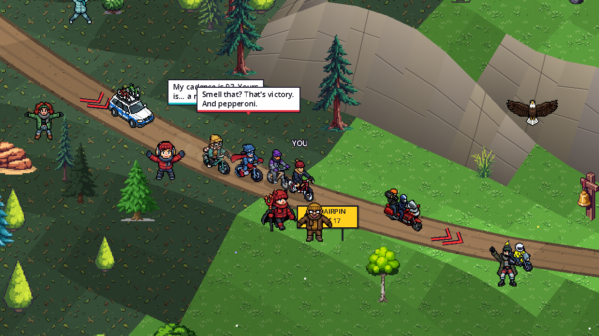
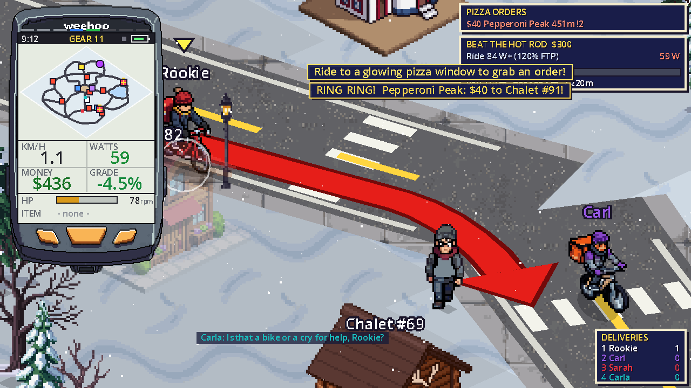
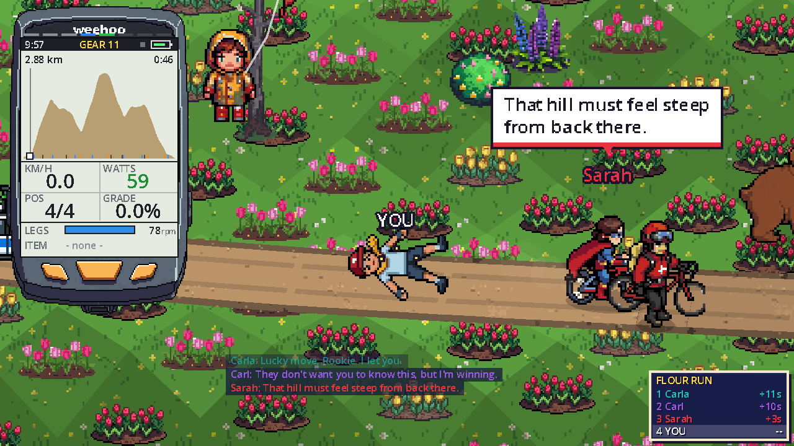
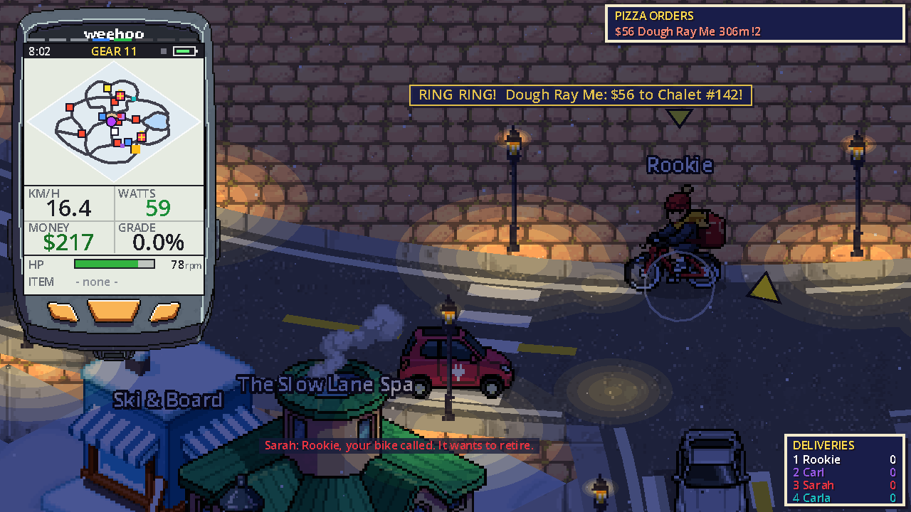
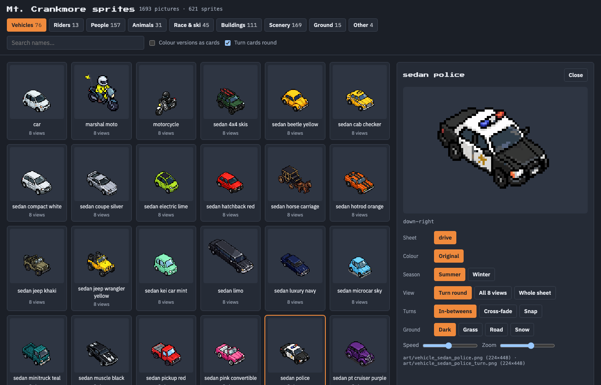

# Mt. Crankmore

> *Pizza pays the bills, cycling is life.*

A colorful 16-bit-style isometric pizza-delivery racing game set in Crankmore Village, an isolated mountain resort town, through all four seasons, built in **Godot 4**.
The game renders at 640x360 and scales up with crisp integer pixels (2x in the default 1280x720 window).
Pedal a **bicycle trainer** (Bluetooth or Wi-Fi, optionally with handlebar controllers) or just a **Bluetooth power meter** to ride; rival pizza bikers (3 by default, up to 7) trash-talk you the whole way.


## What's new in 0.8

* **A whole 90s town that lives.** Day turns to night over an hour, street lamps come on, it rains through spring to fall and snows in winter. Dozens of happenings: a marching band, parades, fireworks, soapbox speakers, group rides, building fires, ambulances, robberies, a runaway dog, a construction site that orders pizza, chairlifts full of skiers, Santa's sleigh on winter nights, seagulls and (in the fall) zombie kids. Nothing pops into or out of sight any more: people walk on and off, cars drive away.
* **Challenges that pay.** Catch a thief or a bike thief, catch a runaway dog, race the hot rod or a kid on a BMX (to a chequered line along the roads, with big red arrows at the turns), pizza rushes, hill sprints, and a mountain rescue up Mt. Crankmore. Each asks for a share of your FTP.
* **Smooth turns.** Every car, truck, rider and townsperson turns through four in-between frames (made with PixelLab) instead of snapping between views, summer and winter outfits alike.
* **Mt. Crankmore climbs like Alpe d'Huez.** 17 stacked hairpins, rock walls and drop-offs; Flour Run sweeps through long bends instead.
* **The bear.** If it catches you, you wipe out, the ski patrol wheels your bike away and brings a new one: 15 seconds gone.
* **Ride anywhere across the road**, oncoming lane included (oncoming cars wait for you).
* **More ways to ride:** Bluetooth power meters, Wi-Fi trainers (Wahoo Direct Connect), and a trainer that goes quiet now reconnects by itself.
* **A sprite viewer** (`tools/sprite_viewer/index.html`): browse every sprite, watch it turn, swap colours and seasons.

| | |
|---|---|
|  |  |
|  |  |



## Play

Download the latest build for your system from the [Releases page](https://github.com/hermeslohin/mt-crankmore/releases) (currently **0.8.3**):

| Platform | File | How to run |
|---|---|---|
| Windows | `MtCrankmore-windows-x86_64.zip` | unzip, run `MtCrankmore.exe` |
| macOS | `MtCrankmore-macos.zip` (universal) | unzip, then right-click the app > Open the first time (it's ad-hoc signed, not notarized). If macOS says it's "damaged", run `xattr -cr "Mt. Crankmore.app"` once |
| Linux | `MtCrankmore-linux-x86_64.tar.gz` | extract, `chmod +x MtCrankmore-linux-x86_64`, run it |

**Mac note:** the app is ad-hoc signed but not notarized by Apple, so the first time you open it, right-click (or Control-click) the app and choose **Open**, then confirm. If macOS says the app is "damaged and can't be opened", that is just the download quarantine flag; clear it once in Terminal and open the app again:

```
xattr -cr "/path/to/Mt. Crankmore.app"
```

The game works with just a keyboard. A trainer needs Python 3 and internet once (see [Bicycle trainer](#bicycle-trainer)).

Or run it from source:

```
godot --path .          # or open this folder in the Godot 4 editor and press F5
```

To build the release packages yourself, install the Godot 4.7 export templates and run
`godot --headless --export-release Windows|Linux|macOS` (presets are in `export_presets.cfg`; output goes to `dist/`).

### Continue / New game
The title screen has **Continue game** (resumes your save, showing your money and deliveries; greyed out if there is no save) and **New game**, which **deletes your save** and starts you over with **$100**, one Rusty Trash Bike and zero deliveries. Your rider setup (Rookie Boy or Girl, FTP, weight, rivals) is kept.

### Rider setup
The first time you start delivering (and any time from the title screen or the pause menu) the **Rider setup** screen asks for:

* **Rider**: **Rookie Boy** or **Rookie Girl**, the character you ride as.
* **FTP** (watts) and **weight**, shown in **kg or lbs**. Your weight is used in the physics, so climbs feel like they do outside.
* **Difficulty**: rivals ride at a share of *your* FTP (as W/kg, at their own weight), the same in town and in a race: about 50% on *Easy*, 65% on *Medium*, 80% on *Hard* and 100% on *Ludicrous* (plus the odd surge in a race), with better bikes on the harder levels.
* **Rival bikers**: how many ride against you, 1 to 8 (default 3).

Change values with LEFT / RIGHT (hold to go faster), on the keyboard or the handlebar D-pad. Without a trainer, W rides at 85% of your FTP and Shift sprints.

### Riding on rails
In town you don't steer: just pedal and the bike follows the road. Your only job is choosing a direction at junctions.
You can still pick your line: squeeze a handlebar paddle to slide across your lane, from the kerb towards the centre line and back. Turns are only picked with the D-pad (or the arrow keys).
A **TURN IN ...m** panel pops up several seconds before every crossroads with three arrows. The yellow one is your choice (straight by default),
and the green **GPS** tag marks the way to your current pickup or delivery. Painted arrows on the road show where you'll go.
One tap is enough: the choice sticks until the junction (no need to hold the button), and the bike curves smoothly through the turn.
If a car is heading for the junction you'll see **CAR COMING!** and you can brake to let it pass.
Pickups and deliveries happen automatically: the bike coasts up to the window and the pizza is handed over as you ride past.

### Controls
| Controller | Keyboard | Action |
|---|---|---|
| pedal | W (210 W), Shift+W sprint | ride |
| D-pad left / right | Left / Right (or A / D) | choose turn at the next junction; in a race, move across the road |
| left / right paddle | | move across the road (town and races); never picks a turn |
| D-pad up | Up | choose straight |
| D-pad down | Down | U-turn |
| A | E / Enter | enter bike shop / race HQ, menu select |
| B | Esc | pause / back |
| RS1 (right shifter) | R or ] | shift up (harder gear) |
| LS1 (left shifter) | Q or [ | shift down (easier gear) |
| Y, RS2 or right power-up | Y or Space | use your power-up |
| LS2 or left power-up | S | brake |
| Z | H | shout at the rivals |
| | F11 or Alt+Enter | toggle fullscreen (the game starts fullscreen) |

The table shows the defaults. Every key and controller button can be remapped from **Controls** (on the title screen, the pause menu and the race pause menu): pick Keyboard or Controller, choose an action, press select, then press the new key or button. LEFT / RIGHT on an action picks which of its (up to three) keys or buttons you are changing, DEL clears one and ESC cancels. A key or button already used by another action is taken from it; the menu actions (turn left / right, straight, U-turn, select, back) always keep at least one key. Controller buttons need the Bluetooth bridge to be running. Your choices are saved in `controls.json` in the game's user folder (apart from the game save, so New game keeps them), and "Reset everything to default" restores the table above.

### Virtual shifting
The bike has 21 gears: 1 is the easiest, 21 the hardest, and you start in 11. The range is wide: gear 1 pushes back about a quarter as hard as gear 11, and gear 21 about three times as hard. There is no front/rear shifter juggling, just up and down; hold a shifter (or the shift key) and after a second it keeps shifting, a gear every half second. The current gear shows at the top of the WEEHOO bike computer. The WEEHOO sits in the top-left corner: a pixel-art handlebar computer (art/ui_weehoo_shell.png) with the town map (or the race's elevation profile) taking most of its screen, then speed, watts, money or position, grade, HP or legs, your power-up and cadence. The deliveries table (or the race standings) is in the bottom-right corner.
With a trainer connected, the gear changes the resistance the trainer sends to your pedals. An easier gear pushes back less, so at the same cadence you make fewer watts and go slower; a harder gear is the reverse. Speed in the game still comes from your real power. Keyboard riders get the same effect: W makes fewer watts and spins faster in low gears.
Resistance needs a trainer that accepts FTMS simulation control.

### Bicycle trainer
On the title screen choose **Connect Trainer**:

1. **Install Bluetooth helper (one time)**: the game sets up a private Python environment in `bridge/.venv` (in a packaged build, in a `bridge` folder in the game's user data folder) with the Bluetooth library. Needs Python 3 (`brew install python` or python.org) and internet, about a minute.
2. The helper starts and scans. Pedal / press a button so your devices wake up; they appear as `TRAINER ...` and `CONTROLS ...` (a Wi-Fi trainer as `TRAINER  KICKR ... (Wi-Fi)`, see below).
3. Select your trainer and your handlebar controllers. The status lines show live power/cadence and the buttons you press, so you can check everything works.
4. Done. Your choices are remembered (`bridge/devices.json`) and reconnect automatically every time you start the game; select a connected device to disconnect it.

Quit any other trainer app first: trainers only accept one connection. On macOS, allow Bluetooth for Godot (or your terminal) when asked
(System Settings > Privacy & Security > Bluetooth).

When a game update needs another library (`bridge/requirements.txt` changed, as it did for Wi-Fi trainers), the game updates the helper by itself the next time it starts it ("Updating the Bluetooth helper..."; needs internet once). If that fails, for instance offline, the helper runs as before: Bluetooth works, Wi-Fi trainers wait for the next try.

Godot itself can't use Bluetooth, which is why the helper (`bridge/trainer_bridge.py`) exists. You can also run it by hand:
`bridge/.venv/bin/python bridge/trainer_bridge.py` (auto-connects the first trainer/controls it finds), `--scan`, `--dump`, `--fake`.

* **Trainer**: standard FTMS. Your real power and cadence drive your speed. The game puts the trainer in simulation mode and sends the road grade (town hills and Mt. Crankmore, -7% to +12%) so climbs get harder and descents easier, with an extra kick when you hop a fallen tree or wade a creek; it repeats the grade every 2 s so the trainer doesn't fall back to a fixed resistance, and goes flat in menus, the bike shop and the ER. The helper log (`grade -> +6.3%`, `trainer: resistance control ready`) shows what is being sent.
* **Wi-Fi trainers**: trainers with Wahoo's Direct Connect (DIRCON), over Wi-Fi or an Ethernet adapter, show up next to the Bluetooth ones as `TRAINER  <name> (Wi-Fi)`: Wahoo KICKR (V5 with the Direct Connect adapter, V6, CORE 2, MOVE, KICKR BIKE), and some Elite (Justo, Avanti) and Tacx (NEO 3M) models. The trainer and the computer must be on the same network (mDNS has to get through, which some guest or mesh networks block). Power, cadence, speed, hills and virtual gears all work as over Bluetooth, and the choice is remembered by the trainer's name, so a new IP address doesn't matter. If your trainer needs Wi-Fi switched on or set up first, do that once in the maker's app (Wahoo's app, for example).
* **Power meter instead of a trainer**: any Bluetooth power meter (Cycling Power: pedals, cranks, spiders) shows up as `POWER ...`. Your power and cadence drive your speed just the same, but there's nothing to push back, so hills and the game's gears don't change how hard it feels: shift your real bike. A trainer that offers both is used as a trainer.
* **Controllers**: see the controls table above.

> **Heads-up:** the trainer side uses a published standard. The handlebar controller protocol is proprietary and reverse-engineered by the community. The button bit-map in `bridge/trainer_bridge.py` is a best-effort default that I could not test against real hardware. If a button misbehaves, run `bridge/.venv/bin/python bridge/trainer_bridge.py --learn`: it asks you to press each button and writes `bridge/buttons.json`, which overrides the defaults.

The game shows connection status at the bottom of the screen ("Trainer + controllers connected").

### Strava
Every ride is recorded: distance, speed, power, cadence and altitude (built up from the road grade, in town and on Mt. Crankmore), plus the pizzas you deliver, the races you win and up to 4 screenshots (deliveries, race finishes and the odd bit of scenery; the best moments are kept). Power and cadence only come from a trainer: on the keyboard only speed and distance are logged, so Strava never gets made-up watts.
The ride is kept until you post it, even if you quit the game, and is posted as a **Virtual Ride**. Its notes look like this:

```
Pizza delivered: 5
Races won: 1

Mt Crankmore - Pizza pays the bills, Cycling is life
https://github.com/hermeslohin/mt-crankmore/releases
```

**Linking (one time).** Strava doesn't give games shared app keys, so you make your own free API app:

1. Title screen > **Strava** > **Open Strava API settings** (or go to <https://www.strava.com/settings/api>) and create an app. Any name, category and website will do; set **Authorization Callback Domain** to `localhost`.
2. Copy the **Client ID**, then pick **Paste Client ID**. Click **Show** next to the Client Secret, copy it, then pick **Paste Client Secret**. They're kept only on your computer (`strava.json` in the game's user data folder).
3. Pick **Link Strava account**, approve Mt. Crankmore in your browser (leave *Upload your activities* ticked) and come back to the game.

**Posting.** Once you're linked, post the ride whenever you like: Pause (Esc / B) > **Post ride to Strava**, or title screen > **Strava** > **Post this ride to Strava**. Post it before you quit: nothing is saved to your computer until the ride is on Strava, so quitting without posting throws it away. Rides need to be at least a minute long. **Discard this ride** starts a new one.

**Screenshots.** Strava's API doesn't let apps add photos to an activity, so after posting, pick **Add screenshots to the last ride**: it opens the activity in your browser and the folder with that ride's screenshots, ready to drag in. Only the last posted ride's screenshots are kept.

## The game

* **Orders**: pizza shops ring you with orders. A pizza man dances outside the shop holding the steaming box over his head; ride up, slow down, and he hands it to you. The steam on your bike shows how hot the pizza still is: deliver before the timer runs out or the customer won't pay at all. Faster means bigger tips, crashes hurt the pizza.
* **Seasons**: the village and the mountain change with the season. It follows today's date (northern hemisphere) unless you pick one with **Season** on the title screen or in the pause menu (LEFT / RIGHT).
  * *Spring*: fresh grass full of flowers, trees in pink and white blossom, tulip beds, butterflies, duck families on the lake, flower baskets on the lamp posts and drifting petals.
  * *Summer*: the village as it always was, plus people playing catch and frisbee, flying kites, picnicking (with pizza) and playing beach volleyball; kites and picnics along the race courses too.
  * *Fall*: golden-orange grass, orange, red and yellow trees, golden larches, falling leaves, pumpkins and jack-o'-lanterns, leaf piles with kids jumping in, scarecrows, hay bales and corn stalks on the lamp posts.
  * *Winter*: snow everywhere, snow on the roofs and pines, bare trees, falling snow, a frozen lake with skaters, a frozen fountain, snowmen, skiers on the hills, townsfolk in bobble hats carrying their skis, and wreaths on the lamp posts. The rivals have something to say about every season.
* **Day and night, rain and snow**: a whole day goes by every hour of play. The light turns orange at dusk and blue at night; street lamps line every road and come on one by one as it gets dark (and go off at dawn), casting pools of light, and cars and bikes ride with their lights on. In spring, summer and fall it rains now and then for 5 to 10 minutes under grey skies; in winter a light snow is always falling, with a heavy snowfall every few minutes.
* **The Crankmore Marching Band**: every twenty minutes or so the whole band (drum major, flags and baton twirler, trumpets, trombones, clarinets and sax, snare drums, bass drums and cymbals, sousaphones) parades twice round the Plaza Loop in its lane; the traffic waits behind it and the townsfolk cheer.
* **Bike theft**: now and then someone runs out of a bike shop pushing a brand-new road bike, swings a leg over and pedals off while the owner bursts out yelling "STOP THIEF! That's a $3,000 bike!". Average 130% of your FTP to run him down ($300): he crashes off it, sits there with his hands up while the owner cheers, and the police take him away.
* **Santa**: on a winter night, every few hours, Santa's sleigh flies over and drops a present on a parachute just ahead of you. Ride over it: it's a Hoofy Bike (a little better than the Rusty Trash Bike; if you've got one already, $100). **My bikes** in the pause menu lists every bike you own and lets you pick which one to ride.
* **Mountain rescue**: now and then a ski patroller at the bottom of a chairlift calls for help. Ride over and press A to take a medical kit up Mt. Crankmore on your own (no rivals, no entry fee) to an injured skier a quarter of the way up, marked with a red cross on the WEEHOO's profile. Reaching them pays $250 and brings you back to town where you were.
* **Paid challenges**: now and then the town asks for a real effort, and a panel under the pizza orders shows the watts it takes and how you're doing. A robber runs out of a shop or the Crankmore Savings Bank, a cop bursts out after him yelling "STOP THAT THIEF!", and he's off on a bike: hold 110% of your FTP to run him down ($150). A woman's dog slips its lead: 80% of FTP catches it ($50). A hot rod rolls up beside you and challenges you to a line 110 m up the road: beat it at 120% of FTP ($300). The quarry always goes as fast as you would at that share of your FTP, so it's about the watts, not the gears.
* **More challenges**: pizza rushes (a party orders five pizzas for five stops; average 80% of your FTP over the lot for a $120 bonus, with a progress bar), hill sprints (a START line lights up at the foot of a climb near you and a FINISH at the top; beat the time you'd do at 105% of FTP for $60), a kid on a BMX who wants a race to a line 150 m away (60% of FTP wins $20), and every half hour or so seagulls after the pizza on your rack (they start 15 m back: hold 90% of FTP to get 40 m clear, or keep them off for 90 seconds, or lose the order).
* **Town happenings**: every five minutes or so: a fun run on a closed stretch of road (cars wait at the barriers, you can ride through), the giant pizza balloon floated round the plaza, a farmers market, a car-wash fundraiser, a wedding at the town hall, a flash mob, cows loose in the street, a hot-air balloon at dawn, movie night at dusk, queues outside Pixel Palace and Rewind Video, a pizza-eating contest. In season: snowball fights (duck!), sledding and the Christmas tree lighting; Easter egg hunts ($5 an egg) and ducklings crossing; beach volleyball, a fishing contest and a lemonade stand; trick-or-treaters, a haunted hayride, the harvest festival and kids in zombie costumes lurching after you (50% of FTP gets you away; get caught and they take $10 of candy money). And rarely, chaos: a power cut at night, a runaway shopping cart coming at you, a burst hydrant flooding the street.
* **Chairlifts and skiers**: three chairlifts climb from the hills by the gondola up Mt. Crankmore, towers marching up cleared lift lines, chairs full of riders going up and empty ones coming down. In winter about fifty skiers carve down the town's hills, and up the mountain in the races up to three chairlifts run through the snow, with forty skiers and snowboarders and two ski schools.
* **Happenings**: besides the small stuff (crowds, dogs, buskers, ice-cream vans...), bigger things come round now and then (each one every ten to forty minutes): a soapbox orator ranting about pineapple on pizza or flattening the mountain while the crowd heckles; the Crankmore Wheelers out on a group ride, two by two; a fire on a roof, with the fire brigade pulling up and hosing it down; someone hurt on the pavement and an ambulance with paramedics; a robbery, with a burglar running from a shop and a cop on his heels (ride into him to stop him for a $25 reward), and the police car taking him away. Once a night there are fireworks.
* **Crankmore Heights**: a building going up west of the plaza, scaffolding, crane and all, with a crew in hard hats working the site. Now and then the builders phone in a big pizza order, and down tools to cheer when it arrives.
* **The Tour de Crankmore champion**: about once an hour of riding, an announcement says Maillot Max, the reigning champion, is visiting town. Get to Race HQ within 5 minutes (a countdown shows under your orders) and you can race him, and your rivals, on any of the three courses. He rides 10% harder than the strongest of them.
* **Townsfolk**: people stroll the pavements all over the village and cheer you on as you ride past, each in their own ways: a jump, or one of three moves of their own (thumbs up, fist pumps, flexing, flags, cowbells, a bow, a little jig, raise the roof...). Race fans do theirs as you go by, and about a third of the roadside fans set off running beside you for a few seconds (as fast as a person can sprint), then pull up, cheer and walk back to their spot.
* **Rivals**: up to eight AI bikers (Cryptic Carl, Super Sarah, Cadence Carla, Wheelie Wanda, Gear Grinder Gus, Margherita Maya, Tubeless Tony, Karate Kim; the first three ride by default) chase the same orders and will snag them if they reach the window first. They talk trash constantly (family-friendly).
* **Bikes**: you start on a Rusty Trash Bike. **Spokes & Stuff** sells better ones (lighter, more aero, tougher, handle better) and repairs. Bikes have HP; walls and cars damage them, and at 0 HP a bike is destroyed.
* **Cars**: get hit and you wake up at **St. Pedro's Hospital** (its air ambulance sits on the helipad on the roof, and every so often spins up, lifts off and flies out over the town, coming back some minutes later to land; it flies over the races now and then too) with a medical bill (money can go negative) and a banged-up bike.
* **The village**: winding roads around a cobbled plaza full of shops and market stalls, a lake with a beach and dock, hotels by the water and the gondola, chalet neighbourhoods in the woods, and only light traffic.
* **Hills**: the plaza and the lakeshore are flat; the chalet neighbourhoods, Summit Road, Ridge Road and the climb up to the gondola roll up to about 7% (Gondola Way pitches to 9%). The grade is shown on your WEEHOO, slows you down uphill and speeds you up downhill (rivals too), and is sent to your trainer.
* **Mt. Crankmore**: enter races at the Race HQ (the checkered building by the gondola). Three gravel races against your rivals (Foothill Gravel Grind, 6 km averaging 4%; Summit Gravel Showdown, 4.4 km averaging 6.5% with ramps up to 12%; and **Flour Run**, a 3 km ride through the flower meadows that climbs, dips and flattens out before finishing back level with the start, about 10 minutes) using a real power/weight/aero/grade model with extra gravel rolling resistance, drafting, power-ups, and prize money. Crossing the line doesn't end the ride: every course runs on for a 400 m cool-down, and the results come up at the end of it. The Gravel Grinder ($8000, the priciest bike in the shop) shines here. The **Fixie** ($2000) is completely impractical, but utterly awesome: stuck in gear 9, no shifting, no brakes.
  * **Drafting**: sit 1 to 9 m behind another rider in the same line (steer with LEFT / RIGHT or the paddles) and the same speed takes fewer watts: about 18% less at 13 km/h, 24% at 17 km/h and 30% at 40 km/h and above. **DRAFTING -n% watts** shows at the bottom of the screen, with wind streaks around your bike. The rivals draft too, off you and off each other.
  * The mountain is built at the same scale as the town (about 3.3 m per tile), so race speeds look like town speeds. Long switchbacks with hairpins zig-zag up a hillside of meadows, pine forest, rock and snow, and the profile rolls: long climbs broken up by short plunges and steep kickers.
  * The climb is a random run of climbs, steep ramps (up to 12%), flats, descents and fast drops (down to -9%) in random lengths, scaled so each course still gains about the same height (the same course seed always gives the same mountain). Above a wandering snow line there is snow in every season: white ground and road, snowy firs and rocks, drifting flakes. A few legs run through tunnels (stone portals; the mound turns see-through while you are inside, and dark with lamps). Yellow warning boards 100 m before every hairpin ("HAIRPIN 3 of 9" with a U-turn arrow), tunnel, steep ramp, fast drop and the snow line, chevron boards round the outside of each hairpin, toasts as you approach each one, and the Weehoo elevation profile marks hairpins (yellow ticks), tunnels (dark bars) and snow (white).
  * **Jumps** on the descents (hit one above ~30 km/h for BIG AIR), **fallen trees** you hop (they scrub some speed), and **creek fords** that drag you down while you splash through. Yellow warning signs come up before each one, and they're marked on the WEEHOO profile (blue creeks, orange jumps, brown logs).
  * **Wildlife**: deer, foxes and squirrels dash across the road in front of you, rabbits bolt, moose wade near the creeks, goats and marmots watch from the rocks, eagles circle overhead, and bears give chase: one rears up and roars as you ride by, then comes after you from where it stood, as fast as you'd go at 110% of your FTP, for about 20 seconds. Hold 110% or it catches you and swipes you off your bike (pull away as it swings and it misses).
* **Power-ups**: about 1 in 8 townsfolk hold up a gift box, and spectators along the race course do too. Ride past with empty hands and they toss you a power-up. You carry one at a time; it shows on the WEEHOO, and **Y** (or Space) uses it. The rivals grab and use them too.
  * *Town only*: **Pepperoni Portal** warps you to the nearest pizza shop with a pizza waiting. **Bike Wrench** fixes your bike to full HP. **Walkie Talkie** summons a pizza mascot that dances in front of the nearest rival and slows them to a crawl for 12 s.
  * *Town and races*: **Pizza Frisbee** knocks a rival within 5 m off their bike for 5 s (out of range, you keep it). **Fire Socks** make you 30% faster for 15 s. **Breadsticks** make you huge for 12 s, and anyone you ride into falls over. **Dough Roller** rolls the hills flat for 15 s: climbs feel like flat road (on the trainer too), descents still count.
* **WEEHOO**: your bike computer in the bottom-right corner. It shows the town map (or the course profile in a race), speed, watts, money (race position in a race), grade, cadence, HP and the power-up you are carrying (or how long Fire Socks / Breadsticks have left). The LED strip along the top lights up with your power, coloured by zone relative to your FTP.
* Progress (money, bikes, HP) is saved automatically. Start over any time with **New game** on the title screen.

### Town life

The town is busy but not crowded: about 170 people (most of them ordinary folk in everyday clothes; the costumed and
uniformed characters are the odd one out) stroll the pavements and the plaza, pop into shops and come out with
something to say, and cheer you (and the rivals) on as you ride past. About 50 vehicles drive the roads, drawn from
around 60 kinds of 90s cars, vans and trucks, each in several paint colours, bouncing on their suspension and puffing
exhaust. Critters live in the parks and woods (squirrels, rabbits, hedgehogs, foxes, cats, dogs, pigeons) and bolt
when you ride close. Every 20 to 40 seconds something happens near you: a crowd cheering on a corner, a dog that
chases you, pigeons that scatter, a cat darting across the road, a marching band, a busker or a mime with an
audience, an ice-cream or food truck with a queue, a kid chasing a ball, a balloon floating away, or a fire engine,
ambulance or police car racing past with its lights flashing. The town hall stands by the plaza. In cold weather (winter, and late fall and early spring) every humanoid wears winter gear (`art/winter_<sheet>.png`: beanies, scarves, gloves, puffer coats; the riders, pedestrians, performers, bakers, gift-givers and race fans), except Tubeless Tony, who dresses the same all year. Every rider has a pizza-throw animation (`art/bike_<rider>_throw_boxed.png` in town, `_throw.png` in races) that plays once when they fling the pizza frisbee. The high street is pure 90s: payphones, phone booths, newspaper boxes, vending machines and blue mailboxes by the shop doors, neon outside the pizza places, Rewind Video (a stack of CRTs outside), the Pixel Palace arcade, Track 9 Records and the Mega Mall with inflatable tube men flailing out front, satellite dishes by the chalets, and a hoop with a boombox and a skate ramp where the kids hang out; rollerbladers, grunge teens, mullet dads and kids in bucket hats and neon windbreakers walk among the townsfolk.

### Race day

The mountain courses are dressed for the race: sponsor tents, bunting, barriers and a crowd at the start and the
finish; a crowd and a marshal packed into every hairpin with hay bales round the outside; cowbell ringers, flag
wavers and sign holders lining the steep ramps and photographers by the jumps; a feed zone with helpers holding out
bottles; fans camped with their camper vans. A devil superfan runs alongside you up one of the climbs, a TV moto and
a marshal moto ride ahead of the leader with the TV helicopter overhead, and the team car follows the last rider. A
mountain cog railway runs straight down the hillside; where it crosses the road there are level crossings whose
lights flash and ring when the train comes by. Up in the snow there is a ski area: skiers and snowboarders carving down the slopes, a
ski school snake, ski patrol, a chairlift whose chairs go round (full on the way up, empty on the way down), the lodge,
a cocoa stand, ticket booth, ski racks, slalom gates, an igloo, and a snowcat and a snowmobile out on the snow.

The ground everywhere (grass, forest floor, alpine meadow, scree, snow, gravel, creek water, asphalt, paving,
cobbles, sand) is drawn with seamless 16-bit textures, lit in a few hard steps by the slope with a light/dark stripe
every few metres of height, so you can read how steep the ground is; coloured chevrons painted on the mountain road
show the grade (blue downhill, then green, yellow, orange and red; double red from 9%).

## Layout

```
project.godot
export_presets.cfg        Windows / Linux / macOS export presets
scenes/main.tscn          entry scene (everything else is built in code)
scripts/game.gd           autoload: money, bikes, physics, save/load, input map
scripts/controls.gd         autoload: key and controller-button bindings (remappable, saved)
scripts/trainer_link.gd     autoload: UDP link to the bridge + keyboard fallback
scripts/trash_talk.gd     autoload: rivals and their trash talk
scripts/season.gd         autoload: the current season, its colours and seasonal drawing helpers
scripts/sky.gd            autoload (Skies): time of day and the weather (rain spells, snowfalls)
scripts/sky_fx.gd         fireworks, drawn over the dark
scripts/night.gd          the dark at night and the pools of light from lamps, headlights and bike lights
scripts/weather.gd        falling snow, rain, leaves and petals
scripts/ride_log.gd       autoload: records the ride (samples, screenshots) and writes it as TCX
scripts/strava.gd         autoload: Strava linking (OAuth via localhost) and ride upload
scripts/main.gd           mode switching and menus
scripts/city.gd           isometric city, traffic, rivals, orders
scripts/race.gd           Mt. Crankmore switchbacks, terrain, obstacles, wildlife + race sim
scripts/race_life.gd      race day: crowds, marshals, tents, feed zone, devil fan, motos, helicopter, mountain railway
scripts/town_events.gd    random town happenings (crowds, dogs, band, buskers, trucks, sirens...) and park critters
scripts/ground.gd         textured 16-bit ground (PixelLab textures) with banded slope light
scripts/flora.gd          trees, bushes, flowers and rocks: seasonal variants picked per spot
scripts/powerups.gd       power-up definitions and drawing (icons, gift, frisbee, mascot)
scripts/hud.gd            HUD and menus
scripts/iso.gd, bike_draw.gd   drawing helpers
bridge/trainer_bridge.py    BLE <-> UDP bridge (Python, bleak)
```

The terrain, roads, water, sky and HUD panels are drawn in code; everything else is pixel art from PixelLab, kept in `sprites/` and packed into `art/` with `tools/import_rider.gd` (riders) and `tools/import_sprite.gd` (the rest). The riders: the PixelLab characters in `sprites/characters/` (10 characters, 3 looks each, with pedalling and wipe-out animations), packed into sheets in `art/` that `scripts/sprites.gd` reads (and the game's user data folder under `art/` overrides, for testing without rebuilding). A sheet is 8 rows of directions (down-right, down, down-left, left, up-left, up, up-right, right, the first being world +x and then turning 45 degrees at a time) by one column per animation frame, with square frames and the wheels touching the ground 12 px above the bottom centre of each frame. Each rider has `bike_<rider>_pizza.png` (carrying a pizza), `bike_<rider>_boxed.png` (riding around town with the empty delivery bag) and `bike_<rider>.png` (no bag, for races), plus the same three with `_fall` in the name for the wipe-out. You ride as `rookie_boy` or `rookie_girl` (picked in the rider setup); the rivals use their short name (`bike_carla*.png`, `bike_kim*.png`, ...). When someone is knocked down by a power-up or hit by a car, their wipe-out animation plays (10 frames a second, then they lie there until they get up). Sheets are built from a character's export with `godot --headless -s tools/import_rider.gd -- <export dir> rows=south-east,south,south-west,west,north-west,north,north-east,east [anim=fall] Idle=bike_<rider>_boxed With_pizza=bike_<rider>_pizza No_bag=bike_<rider>` (`rows=` picks which export pose goes on each row, `anim=` which animation to pack: `pedaling` by default). The other art: each pizza shop's baker (`art/chef_<shop>_dance.png` while an order waits, holding a pizza overhead, and `art/chef_<shop>_tap.png` the rest of the time; the shop name in lower case with underscores), the Walkie Talkie's pizza mascot (`art/mascot_dance.png`), the thrown pizza (`art/pizza_spin.png`), the traffic (`art/vehicle_<kind>.png`, 8 rows of directions: a white car and truck that are painted a random colour, a motorcycle, and 39 coloured ones: sports, luxury, taxi, retro, police, wagon, limo, convertible, hot rod and microcar sedans, a pickup, snowplow, lumber flatbed, fire, garbage, ice-cream, tow trucks and a tractor, a camper van, ambulance, school bus, mail van, food truck, minivan, SUV, jeep, small pickup, sport wagon, checker cab, vintage roadster, cement mixer, box truck, milk tanker, logging truck, hippie camper and bakery van), St. Pedro's Hospital (`art/hospital.png`) and its air ambulance (`art/heli_medical.png`, 8 isometric directions like the vehicles, a column per tilt: level, nose down, nose up, banked left and right) the race-course wildlife (`art/animal_<kind>_idle.png` and `_run.png` for the bear, deer, moose, goat, marmot, rabbit, squirrel, fox, elk, wolf, raccoon, hedgehog, chipmunk, skunk, bighorn, badger, mountain lion, coyote, porcupine, otter, beaver and lamb, plus `animal_bear_roar.png` and `animal_bear_swipe.png`, all facing right and mirrored for left; dark bears are tinted; `animal_eagle_fly.png` for the circling eagles and `animal_butterfly.png` for the butterflies, tinted per butterfly) the people (`art/ped_<design>_walk.png` and `_cheer.png` for the twelve pedestrian designs, which also line the race course; `giver_red_wave.png` and `giver_blue_wave.png` for the roadside gift-givers; `person_skier.png` and `person_skater.png`), the scenery (`art/scenery_*.png`: trees and rocks that change with the season, flower beds, pumpkins, leaf piles, hay, snowmen, a scarecrow, kites, picnics, a volleyball net, market stalls, beach umbrellas, street lamps, the fountain, the dock, signs, clouds and the power-up icons), a few 8-direction objects (`art/obj_*.png`: rowboat, canoe, ducks, gondola cabin, dirt jump, fallen log, race arch) and the buildings. Every named building has its own picture, `art/building_<name>.png` (the name in lower case with underscores): the 7 pizza shops, 2 bike shops, race HQ and gondola base, the 34 shops, 20 hotels and 6 condo blocks, plus `building_chalet_01` to `_32`, 32 designs shared out at random over the chalets. Each is drawn standing on its lot's near corner with its entrance on the right-hand wall, and mirrored when the door faces the other way (a 3x2 condo mirrored is the 2x3 one). A name with a number on the end ("Alpine Lodge II") reuses the picture. Dev helpers: `PIZZA_DEBUG=city|race|shop|er|flow|rails|roads|overview godot --path .`; `PIZZA_DEBUG=shot PIZZA_OUT=dir [PIZZA_AT=x,y;...|junctions|shops|er] [PIZZA_CARRY=1]` saves screenshots (optionally carrying a pizza); `PIZZA_DEBUG=race_shot [PIZZA_COURSE=0|1] PIZZA_OUT=dir` saves race screenshots at the first jump, log, creek and wildlife; `PIZZA_DEBUG=powerups PIZZA_OUT=dir` tries every power-up in town and in a race and saves a screenshot of each; `PIZZA_DEBUG=animals PIZZA_OUT=dir` lines up one of every race animal and saves screenshots of them standing, running and roaring; `PIZZA_DEBUG=buildings` prints how many buildings of each kind and size the town has; `PIZZA_DEBUG=events PIZZA_OUT=dir` sets off every kind of town happening next to the player and saves a screenshot of each; `PIZZA_AT=townhall` takes the screenshots at the town hall, `PIZZA_AT=nineties` at the 90s shops, tube men and hangouts; `PIZZA_DEBUG=wipeout PIZZA_OUT=dir` knocks the player and a rival down, then hits the player with a car, saving screenshots of the wipe-out animations; `PIZZA_DEBUG=readme godot --path .` regenerates the README screenshots in `docs/`; `tools/event_viewer.sh` (or `PIZZA_DEBUG=eventviewer`) is the event viewer: ride around town and step through every happening, call-out and challenge one at a time with ] / N (next), [ / P (back) and R (again), each in the season and at the time of day it needs, your save put back when you quit; `PIZZA_NO_SAVE=1` never writes the save file (for tests and screenshot runs); `PIZZA_SEASON=spring|summer|fall|winter` forces a season; `PIZZA_TIME=<hour 0-24>` holds the clock and `PIZZA_WEATHER=rain|snow|clear` the weather; `PIZZA_AT=edges` screenshots the buildings near the edge of the map; `PIZZA_DEBUG=seasons [PIZZA_OUT=dir]` saves the title view and each kind of seasonal scenery in every season; `PIZZA_DEBUG=ride [PIZZA_OUT=dir]` rides for a few seconds and writes the Strava TCX file and screenshots; `PIZZA_POPS=<frames> [PIZZA_POPS_EVENTS=1]` (with `PIZZA_DEBUG=city`, works headless) prints anything in town that pops into or out of sight, jumps or changes its look on screen, with a summary every that many frames (`tools/pop_watch.gd`; `PIZZA_POPS_EVENTS=1` also sets off a happening every 15 s).

## Sprites

The PixelLab rider sprites (10 characters, 3 states each, with pedalling and fall animations) are in `sprites/`, with their own README. They live only in this repo.
